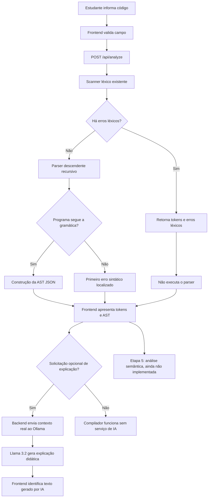

# Fluxo e notas para Materiais e Métodos

## Fluxo implementado e próxima etapa

## Notas metodológicas registradas

- **Entrada:** código textual do subconjunto educacional de Python, limitado a 100.000 caracteres.
- **Analisador léxico:** scanner manual já existente; classifica tokens, registra linha/coluna e acumula erros.
- **Parser:** descendente recursivo manual, sem biblioteca externa. Cada nível de precedência tem uma função; a gramática está em [`gramatica.md`](gramatica.md).
- **Posições e blocos:** o parser reutiliza linha e coluna dos tokens para delimitar instruções e blocos indentados. Não altera tokens nem adiciona tokens de fim de linha ao scanner.
- **Saída:** AST JSON com tipo, atributos, filhos, posições inicial/final e produção reconhecida; diagnósticos sintáticos claros.
- **Decisão em erro léxico:** parser não executa; os tokens parciais e erros léxicos continuam visíveis para evitar diagnósticos sintáticos derivados de entrada incompleta.
- **Recuperação:** apenas o primeiro erro sintático é retornado; não há sincronização por `;` ou dedent.
- **IA opcional:** Ollama + `llama3.2` é explicação auxiliar. O backend recompila a entrada e inclui no contexto somente resultados produzidos pelo scanner/parser; a IA não define tokens, AST ou diagnósticos oficiais. A aplicação base não depende do modelo.
- **Critérios de avaliação definidos antes dos resultados:** aceitar produções documentadas; rejeitar construções fora do escopo e entradas incompletas; conferir precedência/associatividade da AST; verificar posição de nós/erros; assegurar contrato léxico legado e endpoint; confirmar que falhas da IA não afetam o compilador.

## Casos de avaliação

1. Atribuição com precedência: `resultado = 10 + 5 * 2`.
2. Associatividade à esquerda: `resultado = 10 - 3 - 2`.
3. Parênteses: `resultado = (10 + 5) * 2`.
4. Condicional aninhada com `else`.
5. Erro léxico: `resultado = @`.
6. Erro sintático por `:` ausente no `if`.
7. Erro sintático por operando ausente no final da entrada.
8. Combinação fora do escopo: `else` sem `if`, comparação encadeada, indentação irregular.
9. Regressão: mesmas entradas léxicas e mesmas categorias/lexemas/posições da Etapa 3.
10. IA indisponível e resposta simulada: scanner/parser continuam funcionando e a interface não expõe stack trace.

## Uso no artigo e pesquisa bibliográfica

As decisões acima podem ser descritas em Materiais e Métodos, acompanhadas pelo fluxograma, gramática, dados de entrada e critérios de avaliação.

### Levantamento bibliográfico preliminar

Foi feita uma busca exploratória de metadados no Crossref e OpenAlex em 24/11/2026, usando consultas sobre parser generator, parsing expression grammars e visualização de árvores sintáticas em cursos de processamento de linguagens. A seleção abaixo é preliminar, baseada em títulos, metadados e resumos disponibilizados pelos catálogos; não substitui leitura integral, estratégia sistemática ou avaliação dos estudos.

1. **Parr e Quong (1995), ANTLR.** O resumo apresenta um gerador de parser que combina flexibilidade de parsers descendentes escritos à mão com conveniência de geração. Descreve predicados para direcionar o reconhecimento, gramáticas LL(k), notação EBNF, integração léxica/sintática e geração automática de AST. Relação com este projeto: adotou-se descida recursiva manual por simplicidade didática; ANTLR oferece geração, poder e recursos maiores, mas introduziria outra ferramenta e geração de código sem necessidade para o subconjunto atual. A comparação é de escopo/arquitetura, não de desempenho.
2. **Ford (2004), Parsing Expression Grammars.** O artigo apresenta PEG como uma base formal orientada a reconhecimento. No resumo, a escolha priorizada de PEG evita a ambiguidade da escolha não determinística das gramáticas livres de contexto e permite um parser linear em tempo, evitando a complexidade de parsers LR e GLR. Relação com este projeto: a gramática implementada é EBNF para um parser descendente recursivo convencional, não PEG; o artigo ajuda a diferenciar estratégias e a justificar que as produções e a precedência precisam estar explícitas.
3. **Almeida-Martínez, Velázquez-Iturbide e Urquiza-Fuentes (2009), VAST.** O resumo descreve uma ferramenta educacional para cursos de processamento de linguagens que gera e visualiza árvores sintáticas e seu processo de construção, independente do parser/gerador usado; relata interface para lidar com árvores grandes e duas avaliações preliminares de usabilidade. Relação com este projeto: a interface atual mostra uma AST hierárquica de texto, pode expandir/recolher, exporta JSON e destaca o trecho do nó selecionado; não implementa visualização passo a passo nem reproduz uma avaliação com estudantes. A publicação impede afirmar que visualização de AST em contexto educacional seja, por si só, novidade. O resumo público não basta para comparar detalhes de interação ou resultados de usabilidade; consulte o artigo integral antes da redação final.

### Referências consultadas

- PARR, T. J.; QUONG, R. W. **ANTLR: A predicated-LL(k) parser generator.** *Software: Practice and Experience*, v. 25, n. 7, p. 789–810, 1995. DOI: [10.1002/spe.4380250705](https://doi.org/10.1002/spe.4380250705). Metadados e resumo: [Crossref](https://api.crossref.org/works/10.1002/spe.4380250705).
- FORD, B. **Parsing expression grammars: a recognition-based syntactic foundation.** In: *Proceedings of the 31st ACM SIGPLAN-SIGACT Symposium on Principles of Programming Languages (POPL 2004)*, p. 111–122, 2004. DOI: [10.1145/964001.964011](https://doi.org/10.1145/964001.964011). Metadados: [Crossref](https://api.crossref.org/works/10.1145/964001.964011); resumo indexado: [OpenAlex](https://api.openalex.org/works/https://doi.org/10.1145/964001.964011).
- ALMEIDA-MARTÍNEZ, F. J.; VELÁZQUEZ-ITURBIDE, J. Á.; URQUIZA-FUENTES, J. **Visualization of Syntax Trees for Language Processing Courses.** *Journal of Universal Computer Science*, v. 15, n. 7, p. 1546–1561, 2009. DOI: [10.3217/jucs-015-07-1546](https://doi.org/10.3217/jucs-015-07-1546). Metadados e resumo: [OpenAlex](https://api.openalex.org/works/W4292150001); texto depositado: [Zenodo](https://zenodo.org/records/7000799/files/jucs_article_29418.pdf).

Este levantamento não é uma revisão sistemática e não sustenta alegações de lacuna, exclusividade ou superioridade. Para o artigo, complete a leitura dos textos integrais, registre bases/consultas/data/critério de inclusão e avalie as ferramentas citadas com os mesmos casos de teste do projeto.
